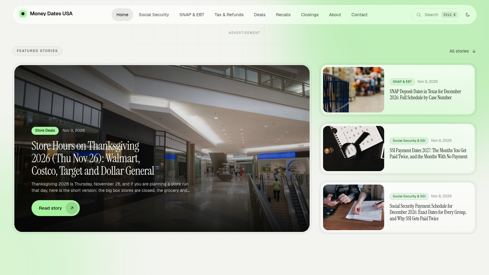

# Blogger WM

A frosted-glass Blogger theme in black, white and light green. It has a full-width layout and shows a sidebar on post pages only.

## Install
1. Blogger dashboard → **Theme** → ▾ next to *Customize* → **Backup** (download your current theme first).
2. Same menu → **Restore** → upload `blogger-wm-theme.xml`.
3. Go to **Layout** and edit the widgets listed below.

## What appears where
| Page | Layout |
|---|---|
| Homepage | Hero slider (big auto-playing slider on the left, 3 post cards on the right), then a 3-column grid |
| Label / search / archive | Big page heading, then a full-width 3-column grid |
| **Post** | Article plus a **sticky sidebar** (table of contents, popular posts, topics, about) |
| Static page | Single centered column, no sidebar |
| 404 | Custom error page |

## Editable in Layout
- **Brand**: the blog title, which is taken from Settings.
- **Menu**: links in the top navigation (LinkList). The same links are used for the mobile menu.
- **Hero slider**: the widget title becomes the small label above the slider ("Featured stories").
  - Leave the widget content **empty** to fill the slider with your 4 latest posts; the 3 side cards then show the next 3 posts.
  - Type a **label name** (for example `Featured`) as the content to fill the slider from that label instead. The side cards then show your latest posts that aren't already in the slider.
  - With fewer than 7 posts, the slider and side cards share whatever posts exist. With 1 post, the slider takes the full width.
- **Sidebar (post pages)**: Popular posts and Topics (labels). You can add more gadgets here.
- **Footer text** / **Footer links**.
- **Social icons (footer)**: each link becomes an icon pill. The icon is picked from the link's **name or URL**: Facebook, X, Instagram, YouTube, LinkedIn, TikTok, Pinterest, Telegram, WhatsApp, Threads, Reddit, GitHub, Discord, Email and RSS are recognized. An unknown name (e.g. "Ko-fi") shows as a text pill instead, so anything works. External links open in a new tab; `mailto:` and internal links (like the RSS feed) don't.

## Ads
The theme ships with **empty ad slots** — no ad code is included, so add your own.

**Popunder Ad (post pages only):** go to Layout → **"Popunder Ad (post pages only)"** → *Add a Gadget* → **HTML/JavaScript**, then paste your popunder script (Monetag, Adsterra, etc.). Title it **Popunder Ad** so you can find it later.
- **Change it** (for example to a different ad network): edit that gadget and paste the new code.
- **Turn it off:** delete the gadget.
- **Add another script ad** (for example a Social Bar): use *Add a Gadget* → HTML/JavaScript in the same section.
Anything in this section loads only on post pages and is never visible on the page itself.

### Banner ads
In **Layout**, each ad slot's name shows the recommended size. Click *Add a Gadget* in that slot → **HTML/JavaScript**, paste the ad code for that size, and leave the title blank. Empty slots stay hidden.

| Slot | Where it shows |
|---|---|
| `header`: Below header | Every page, under the navbar |
| `post-middle`: in-article 1/3 | Post pages, inside the text |
| `post-middle-2`: in-article 2/3 | Post pages, inside the text (8+ paragraphs) |
| `sidebar-top` / `sidebar-bottom` | Post pages, in the sidebar |
| `footer`: Above footer | Every page |

## Customize
- **Accent color**: Theme → Customize → Advanced → *Accent (light green)*.
- **Container width**: `--container` in the CSS (default `1600px`).
- **Fonts**: Geist (UI) and Instrument Serif (headlines), loaded from Google Fonts.

## Built-in features
Dark/light mode (follows the system setting and remembers the reader's choice), search overlay (⌘K / Ctrl K / `/`), reading progress bar, reading time, auto-generated table of contents with scroll highlighting, share buttons and copy-link, related posts (matched by the post's first label), previous/next post links, styled threaded comments, scroll-reveal animations and a back-to-top button.

## License
[MIT](LICENSE) — free to use, modify and redistribute, including in commercial projects. Keep the copyright notice in the file or credit the theme somewhere visible if you redistribute it.

## Tips
- Give each post a **label**. The first label is used for the card chip, breadcrumb and related posts.
- Use **Heading** formatting in the post editor (it outputs `h2`/`h3`). The table of contents only appears when a post has two or more headings.
- Each post's first image is used as its card thumbnail.
